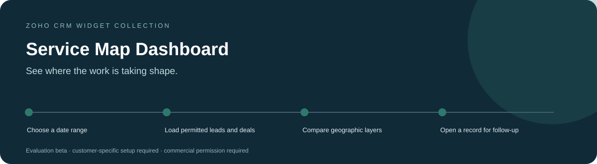
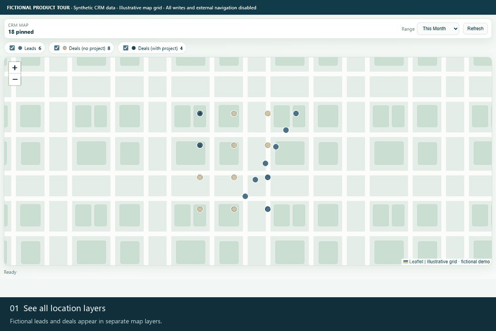
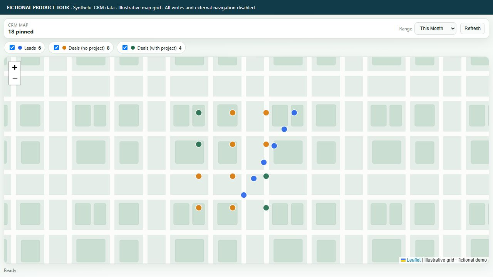
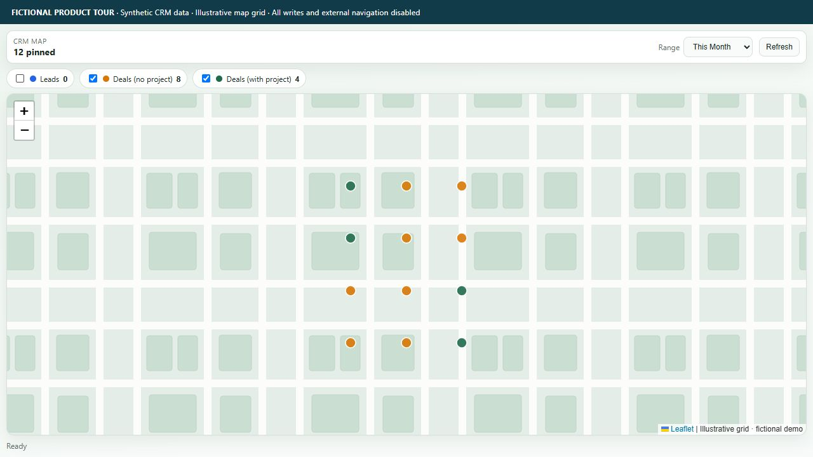
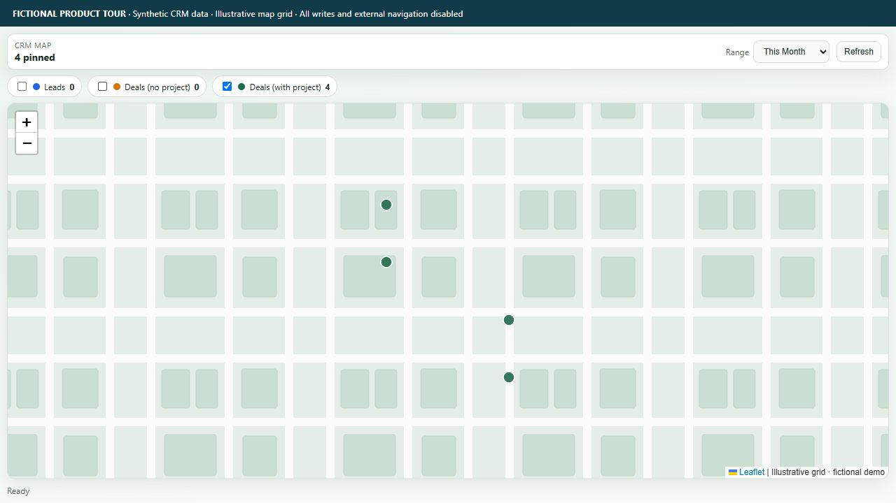
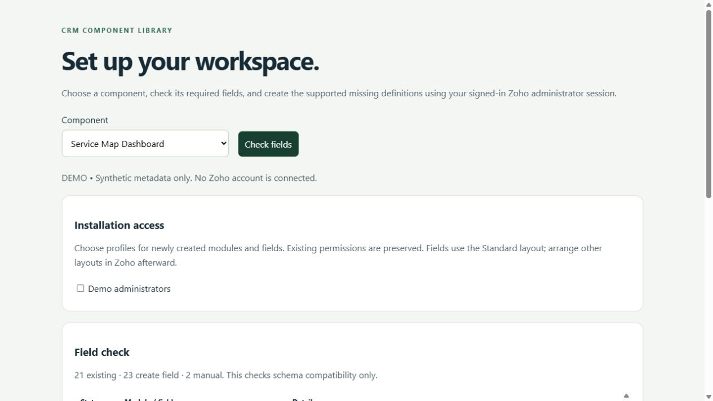

<h1 align="center">Service Map Dashboard for Zoho CRM</h1>

<strong>See where the work is taking shape.</strong> A geographic dashboard that plots leads and deals in separate layers so teams can review where sales opportunities and project work are concentrated.

Tested &amp; In Development / Pre-Release · Development showcase and fictional-data tours

> **Tested & In Development / Pre-Release.** Testing covers documented development checks only. Production readiness and customer-specific acceptance remain pending.

> [!IMPORTANT]
> **Showcase only.** This public repository contains product information and fictional demonstration media. It provides no software source, installable packages, free beta downloads or software license. Release availability remains pending; any future deployment scope will be agreed privately. Product validation and the limitations below still apply.

[Discuss a commercial installation](https://github.com/RawPowered/Zoho-Service-Map-Dashboard/issues/new?template=commercial-inquiry.yml) · [Deployment model](DEPLOYMENT.md) · [Commercial terms overview](COMMERCIAL.md)

## A focused workspace

Operations and sales leaders coordinating work across a service area.

| Capability | What it helps with |
| --- | --- |
| **Distinct map layers** | Separate leads, deals without a project and deals with project-stage context. |
| **Time filters** | Review supported date ranges rather than mixing every historical record into one map. |
| **Record handoff** | Inspect a plotted item and open the permitted CRM record. |

## Product tour

These captures show the actual widget running against an isolated fictional-data adapter. No customer account, real person, customer branding or production credential is used. CRM writes and outbound navigation are blocked. Map backgrounds are illustrative grids; required third-party attribution is retained.

### Watch the workflow

The animation is a sequence of actual interface states, held for readability. It is not a recording of a live customer installation.

### Start with the workspace

Fictional leads and deals appear in separate map layers.

### Follow the next actions

<table><tr><td width="50%"><strong>Focus on deals</strong>
Hide the lead layer to compare the remaining work.
</td><td width="50%"><strong>Isolate project-stage work</strong>
Hide deals without project context to focus the view.
</td></tr></table>

### Prepare the account deliberately

A separately licensed Schema Setup companion can be scoped to this product. It reads field metadata, identifies compatible existing definitions, and distinguishes missing definitions from manual steps. A field plan does not certify that functions, workflows or permissions are complete.

All records and sample labels are fictional. Preview tooling and installable software are not distributed through this public showcase. Commercial deployment still requires the documented account-specific acceptance checks.

## Commercial deployment

Licensed widget packages are supplied privately for the agreed customer organization. An authorized administrator installs them directly inside Zoho CRM using **Zoho internal hosting**, sets the supplied entry page and attaches the intended CRM placement. A Zoho CRM homepage/dashboard widget; no single record is required.

Schema, access profiles, workflows and service connections are reviewed for the licensed installation. A showcase screenshot does not certify compatibility or complete those steps. WordPress integration, where licensed, runs on the customer's live WordPress host and is configured separately. [How the platforms fit together](DEPLOYMENT.md).

## Data access and responsibilities

**Reads:** Lead and Deal records visible to the signed-in CRM user, using configured date, project-stage and coordinate fields.

**Writes:** The dashboard source reads CRM records and opens them for review. It does not implement CRM record mutation. The separate Schema Setup widget can create metadata only after an administrator explicitly applies a plan.

**External services:** Public map tiles and links used by the map view. Map tile requests expose the viewed map area to the tile provider.

## Current product boundaries

- Records without usable coordinates cannot be plotted.
- Date presets and page caps can limit the visible dataset; this is not an unlimited analytics export.
- Project-stage classification is configurable source logic and must match the customer's workflow.

Status: **Tested & In Development / Pre-Release**. Account-specific acceptance is required before production activation. Credentials and customer data are configured privately in the customer environment.

## Commercial availability

Request licensing, installation, account mapping or support through a [commercial inquiry](https://github.com/RawPowered/Zoho-Service-Map-Dashboard/issues/new?template=commercial-inquiry.yml). Include only a general use case; public issues must not contain customer records, account IDs, secrets or confidential details. Pricing, permitted organizations/users, delivery scope and support terms are agreed privately. This page does not collect payment or grant permission to use the software.

## Explore the collection

[Widget collection](https://github.com/RawPowered/Zoho-CRM-Widgets) · [Automation overview](https://github.com/RawPowered/Zoho-CRM-Automations) · [PowerPortals](https://github.com/RawPowered/PowerPortals-Showcase)

- [Service Map](https://github.com/RawPowered/Zoho-Service-Map)
- [Get Directions](https://github.com/RawPowered/Zoho-Get-Directions)
- [CEO Pipeline](https://github.com/RawPowered/Zoho-CEO-Pipeline)
- [Project Scoper](https://github.com/RawPowered/Zoho-Project-Scoper)
- [Parts and Scope Builder](https://github.com/RawPowered/Zoho-Parts-and-Scope-Builder)
- [Project Task Builder](https://github.com/RawPowered/Zoho-Project-Task-Builder)
- [Financial Scope](https://github.com/RawPowered/Zoho-Financial-Scope)
